# Research Agent

基于大模型的智能研究与知识库问答平台，集成 Agent 任务编排、工具调用、资料检索、图片生成和研究产物展示。

项目采用 **React 工作台 + Java Agent 后端 + Python 工具服务** 的结构。Java 管理任务与执行过程，Python 提供检索、文档处理和数据分析能力，前端展示对话、证据与文件产物。

> 本项目是以 Java 后端为主的 AI Agent 应用工程。各项 AI 能力需要配置对应的模型、工具或外部服务。

## 目录

- [项目定位](#项目定位)
- [信息来源](#信息来源)
- [核心功能](#核心功能)
- [Intelligent UI：从回答到交互界面](#intelligent-ui从回答到交互界面)
- [页面展示](#页面展示)
- [研究成果与报告展示](#研究成果与报告展示)
- [技术栈](#技术栈)
- [系统架构](#系统架构)
- [项目结构](#项目结构)
- [快速开始](#快速开始)
- [配置说明](#配置说明)
- [开发与验证](#开发与验证)

## 项目定位

- **多源信息研究**：通过主 Agent 与子 Agent 分工，结合网页搜索、正文提取和已配置的公开信息或登录态工具，收集研究资料，并整理来源、观点与信息缺口。
- **私有资料证据链**：通过 MRAG 处理文件与网页资料。根据解析器、视觉模型和检索服务配置，支持 PDF、Word、PPT、文本及图片等资料；回答中保留相关片段与来源引用。
- **记忆与流程复用**：通过工作记忆、上下文压缩和长期记忆保存有用上下文，并利用技能包与子 Agent 定义复用任务流程。
- **分析与产物交付**：结合 Python 数据分析、已配置的代码执行环境及文档生成工具，完成资料整理、统计和可视化，以 GenUI 交互内容、图表或 HTML、PDF、Word、PPT 等文件交付结果。E2B 沙箱需要单独配置。

### 把分散资料组织成可追溯的研究

技术文档、社区讨论、视频内容与企业内部资料分散在不同来源中。一次研究往往需要反复搜索、阅读、整理和对比，结论与原始依据也容易脱节。

Research Agent 将这些步骤放进同一工作台：用户提出目标，Agent 拆解任务并调用可用工具，知识库提供私有资料，分析工具处理数据，前端呈现回答、证据与文件产物。执行过程保留在会话与账本中，方便回看和继续研究。

不同渠道通过搜索工具、公开来源技能、登录态只读工具或 MCP 接入。可访问范围取决于平台接口、凭据、网络和依赖配置；配置一个渠道不会自动开启全部来源。

### 为什么做这个项目

项目面向技术研究、资料问答和数据分析中的重复工作：从多个来源寻找材料，将零散信息组织成结论，再制作可以阅读、编辑或分享的报告。

Research Agent 把大模型的推理与工具执行连接起来，提供任务编排、知识库、子 Agent、模型管理与产物展示，让用户可以在同一工作台完成从提问到交付的过程。

### 典型使用场景

以下是可提交的任务示例，不是已经完成或验证的真实案例。

1. **技术选型前**：比较候选技术的官方文档、版本记录与社区讨论，整理功能差异、适用条件和待验证问题，交付带来源的对比报告。
2. **知识库问答时**：导入制度、产品说明或技术资料，提问并获取基于材料的回答，查看引用片段，减少反复翻阅文件的工作。
3. **数据复盘时**：上传销售数据，统计月度收入、产品占比和环比变化，生成图表与 HTML 分析报告，并保留处理脚本。[销售 CSV 示例](assets/examples/sales-demo.csv)包含 144 条模拟订单，可用于测试。
4. **研究报告交付时**：将收集到的资料整理为摘要、章节、对比表与来源清单，根据任务输出 HTML、PDF、Word 或 PPT。
5. **重复任务执行时**：为搜索、分析和报告生成配置专用子 Agent，结合技能包限定职责与工具范围，复用已有流程。

## 信息来源

项目同时提供 Python 工具和运行时技能。下表区分了直接工具能力与需要上游依赖的公开来源技能，列出的渠道不代表当前部署全部可用。

| 信息渠道 | 可用于研究的内容 | 接入方式与条件 |
| --- | --- | --- |
| 公开网页 | 搜索结果、页面正文、官方文档与公告 | 网页搜索和正文提取工具，按所选服务配置 |
| 私有文件与网页知识库 | 制度、产品资料、技术文档及引用片段 | MRAG；需要解析、Embedding 和检索配置 |
| Reddit | 帖子、社区列表、搜索结果与评论 | 登录态只读工具；公开 RSS 可经来源技能读取 |
| Twitter / X | 推文、线程、文章与用户公开动态 | 登录态只读工具，需要配置服务端凭据 |
| 雪球 | 行情、搜索结果与社区内容 | 登录态只读工具或公开来源技能；受接口与时效限制 |
| RSS / Atom | 新闻、博客和站点更新 | 公开来源技能，需要有效订阅地址与相应依赖 |
| YouTube | 公开视频信息、字幕及评论 | 公开来源技能，需要上游工具且内容可访问 |
| Bilibili | 公开视频信息、字幕及社区内容 | 公开来源技能，需要上游工具与可访问内容 |
| Hacker News | 技术新闻、故事与讨论 | 公开来源技能 |
| V2EX | 公开主题与开发者讨论 | 公开来源技能 |
| GitHub | 仓库、版本、Issue 与 PR 等公开信息 | 公开来源技能，需要相应 CLI 或接口配置 |
| LinkedIn | 可公开访问的个人或企业页面 | 公开来源技能，受页面可访问性限制 |
| Telegram | 公开频道内容 | 公开来源技能，不包含私有频道 |
| Stack Exchange | 公开问题、答案与社区信息 | 公开来源技能 |
| 业务数据库 | 已授权的数据与分析结果 | 按 Table RAG / NL2SQL 和数据分析工具配置接入 |

小红书、Polymarket 等未在本节确认为当前项目直接提供的渠道，不作默认支持承诺。新增来源可通过技能或 MCP 扩展，并以实际调用结果验证可用性。

## 核心功能

| 功能 | 说明 |
| --- | --- |
| 智能对话与任务执行 | ReAct、计划执行策略、多轮对话及执行过程展示 |
| 子 Agent | 配置角色、系统指令、模型、工具范围与执行步数，由主 Agent 调度 |
| 知识库问答（MRAG） | 导入文件和网页，解析、分片、向量化、检索并生成带引用的回答 |
| 图片工作室 | 文字生成、参考图片编辑、比例尺寸、生成数量与作品记录 |
| 模型配置 | OpenAI 兼容接入、模型启停和连接测试，支持配置 qwen-plus 等模型 |
| 技能与 MCP | 管理技能包与 MCP 连接器，按需扩展 Agent 工具能力 |
| 研究与数据分析 | 通过已配置工具完成搜索、网页提取、代码计算和报告生成 |
| 产物预览 | 展示 HTML、图表、图片和文档，支持 GenUI 与 3D 内容渲染 |
| Intelligent UI | 根据任务组合文字、交互组件与 HTML 产物，支持地图行程、数据联动、表单动作及状态恢复 |
| 会话与运行管理 | SSE 推送、执行账本、历史回放、运行控制及人机协作节点 |
| 记忆与上下文管理 | 工作记忆、上下文压缩与长期记忆相关能力 |
| 每日推荐 | 后台生成推荐任务，支持启动补生成、每日调度与失败重试 |
| 账号与工作台管理 | 登录、个人资料、精品对话和用量统计，后端按身份控制访问 |

### 知识库处理流程

```text
文件 / 网页 → 解析与分片 → Embedding 向量化 → Qdrant 存储
用户问题 → 查询处理与召回 → 重排 → 大模型回答 → 来源与证据展示
```

MySQL 保存用户、模型、会话和执行记录等业务数据；Qdrant 用于向量检索；SQLite 用于 Python 文件服务及知识库的部分元数据。具体检索模式还可接入 Elasticsearch、视觉模型和重排服务。

## Intelligent UI：从回答到交互界面

Intelligent UI 让 Agent 根据任务生成可以操作的结果：旅行规划呈现地图和地点列表，数据分析呈现可筛选的图表与表格，交互演示或小游戏交付为可运行的 HTML。用户可以继续用自然语言修改已有界面。

本项目参考 ChatGPT Intelligent UI 的交互形式，采用自己的组件、Surface 协议和执行链路实现；属于功能探索与工程实现，不代表与 ChatGPT 全部能力等同。

### 已实现的能力

| 能力 | 交互与实现 |
| --- | --- |
| 多画布与展示容器 | 同一消息可包含多个 Surface；支持内嵌、侧栏与沉浸展示，按 Surface 身份隔离状态 |
| 渐进式呈现 | 完整、可校验的子树增量提交；非法或过期事件不覆盖已提交内容。HTML 完整验证发布后才执行脚本 |
| 本地数据联动 | 共享版本化数据资源，支持筛选、排序、参数计算及图表/表格联动；本地操作无需再次调用 Agent |
| 远程 Action | 表单连接服务端注册动作，记录执行状态、幂等与版本冲突，支持审批、查询恢复和取消 |
| Intelligent Map | 高德地点搜索、路线规划、地点图片、地图与列表联动、站点调整和路线重算，支持 2D/3D 切换 |
| AI 景点简介 | 点击地点查看详情，通过模型流式生成简介，标注 AI 生成信息供参考 |
| HTML 交互产物 | 支持小游戏、交互演示和报告；提供源码、重新运行、版本选择及历史预览 |
| 交互恢复与界面选择 | 版本化保存筛选、选中项、地图视口、产物版本与动作结果；Planner 在文字、组件和产物之间选择展示方式 |

### 示例一：地图路线与行程编辑

地点列表与地图联动，支持调整顺序、替换或删除地点、添加站点和重新规划。地图跟随项目全局深浅主题；3D 展示效果取决于高德数据覆盖与设备能力。

**浅色主题 · 3D 地图与行程侧栏**

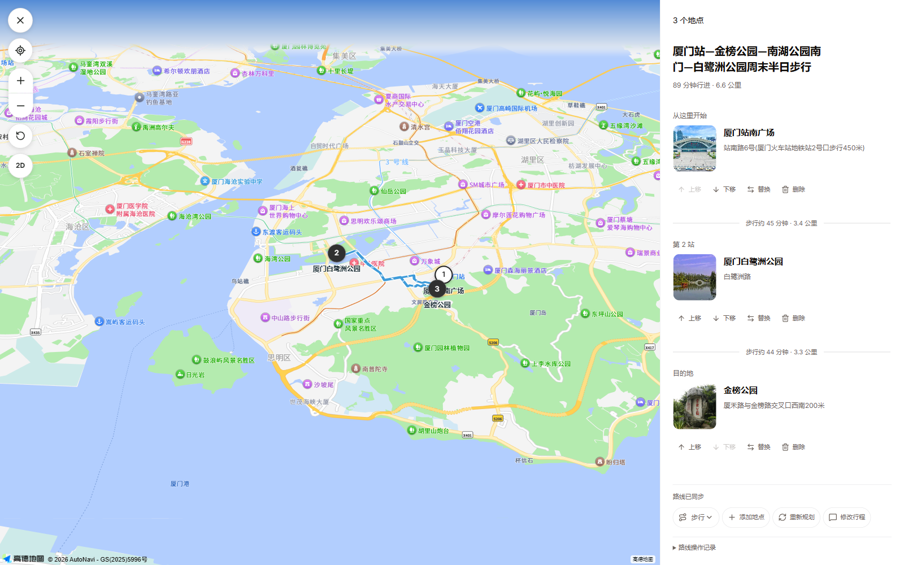

<details>
<summary>深色地图、景点简介与 HTML 小游戏示例</summary>

**深色主题 · 真实路线与地点图片**

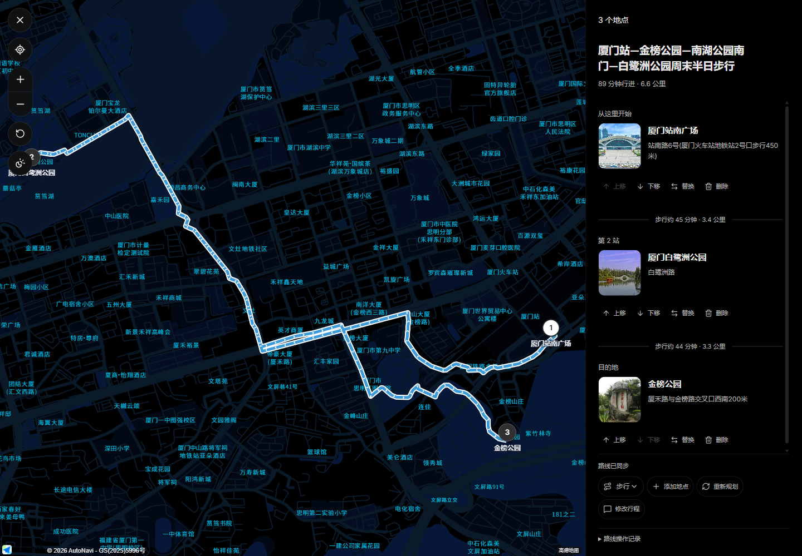

**地点详情 · AI 生成简介**

下图为流式生成完成后的详情面板。简介由模型生成，不能代替实时开放时间、票价或通行信息查询。

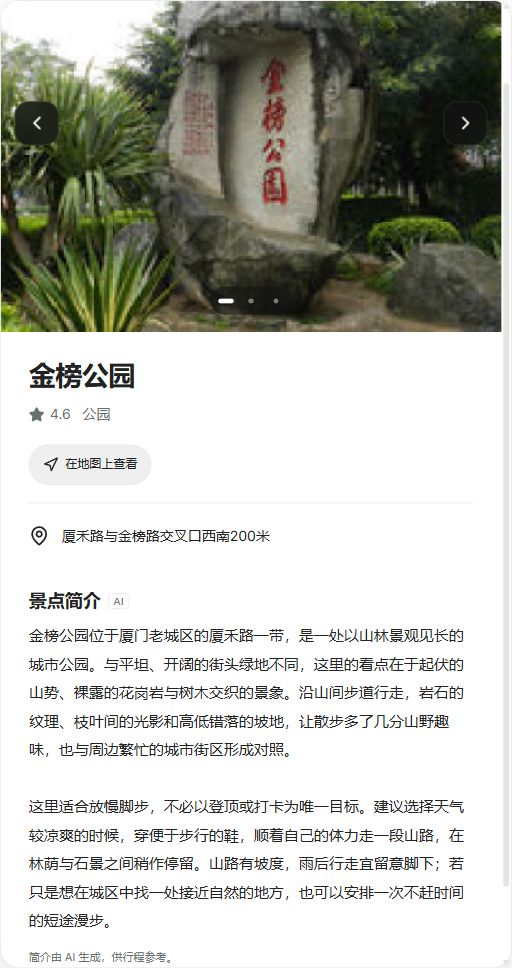

**HTML 小游戏 · Canvas 交互验收示例**

这是早期基线验收保存的可玩小游戏截图，展示方向控制、命中目标与重新开始；不代表当前容器的最终视觉样式。游戏运行内存默认不跨刷新恢复，只有实现并验证版本化存档协议后才支持保存进度。

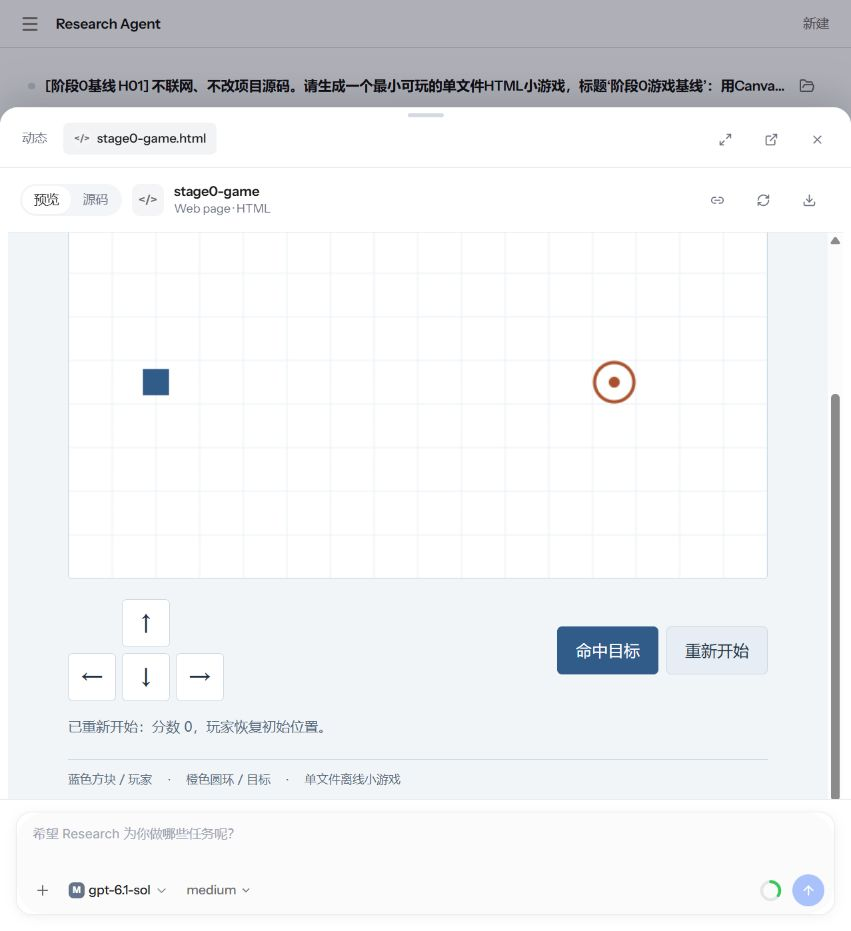

</details>

上述图片来自本项目本地验收记录，地图使用真实高德服务数据；截图记录的是采集时的路线和界面状态，并非实时行程建议。

### 可以尝试的任务

- **旅行规划**：“从厦门站出发，规划周末半日步行路线，选 3 个适合放松的地方，在地图显示路线，并允许替换站点。”
- **销售看板**：“分析上传的销售 CSV，展示月度趋势、产品汇总和数据表，支持筛选并保持图表与表格同步。”
- **分账计算**：“生成一个聚餐分账器，支持人数、金额和服务费输入，即时显示每人金额，并处理非法输入。”
- **交互小游戏**：“生成可直接运行的单文件 HTML 贪吃蛇，支持方向键 / WASD、开始、暂停、重新开始和计分。”

这些是任务提示词示例。实际生成结果取决于模型、工具、输入数据和服务配置。

### 配置与验收边界

真实地图需要配置 `AMAP_JS_KEY`、`AMAP_SECURITY_JSCODE` 和服务端 `AMAP_WEB_KEY`，并按高德控制台配置域名及安全策略。模型需要可用的 API 凭证；远程动作仅能使用服务端注册且当前身份有权调用的能力。请勿将密钥提交到仓库。

后端提供四个独立能力开关，修改启动环境后需重启：

| 能力 | 环境变量 |
| --- | --- |
| 增量提交 | `RESEARCH_UI_STREAMING_ENABLED` |
| 远程动作 | `RESEARCH_UI_ACTIONS_ENABLED` |
| 地图 | `RESEARCH_UI_MAPS_ENABLED` |
| 界面 Planner | `RESEARCH_UI_PLANNER_ENABLED` |

当前已完成多项自动化和本机交互验证；默认模型鉴权修复后，景点简介流式生成已复测通过。五类真实模型完整场景、真实手机与发布网络、完整长时资源验收仍待完成，不能将当前状态视为生产发布验收全部通过。敏感表单不参与恢复，恢复操作不应重复执行已完成动作。

## 页面展示

以下截图来自当前本地项目。工作台使用深色主题，登录页使用独立的浅色设计；知识库回答使用模拟测试资料。

### 对话工作台

推荐任务、模型选择和 Agent 执行入口。

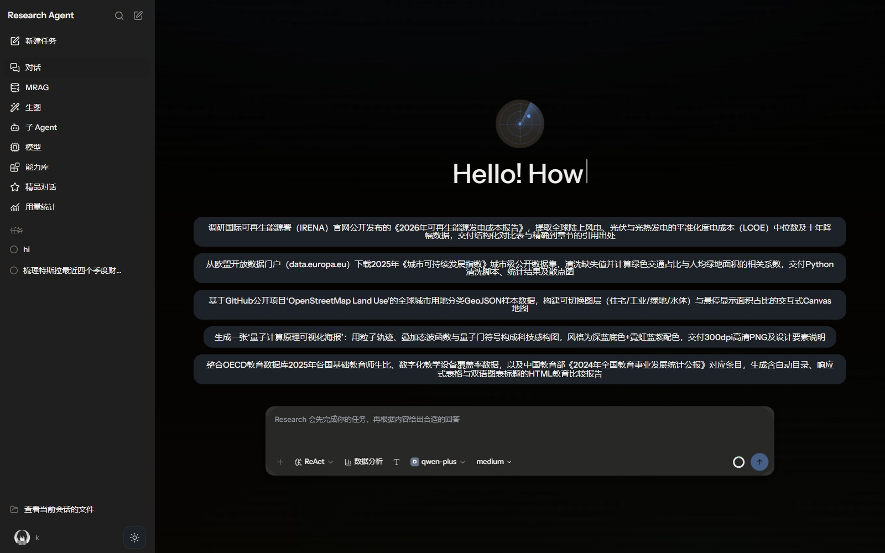

### 图片工作室

画面描述、参考图片、比例尺寸、生成参数与作品记录。

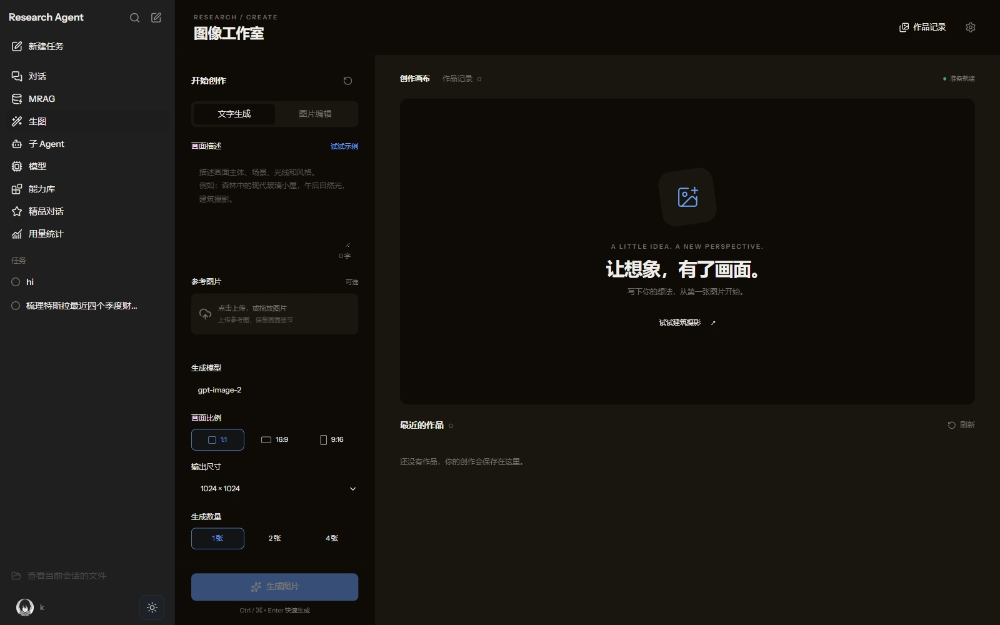

### 知识库问答

基于模拟差旅报销资料的结构化回答，包含来源引用。

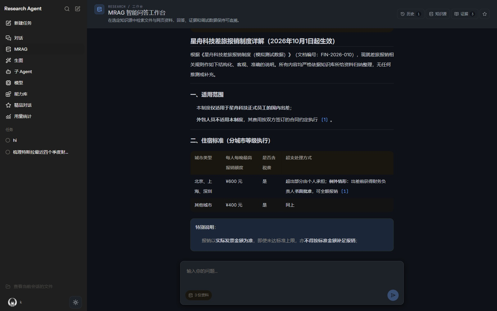

<details>
<summary>更多页面：登录、子 Agent、模型配置与能力库</summary>

### 登录页面

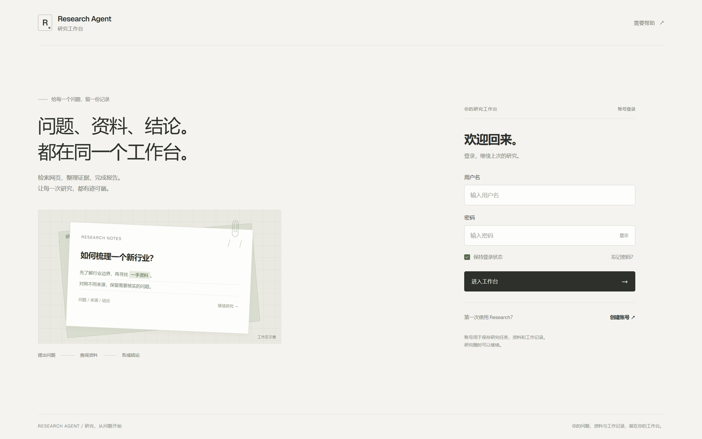

### 子 Agent 装配

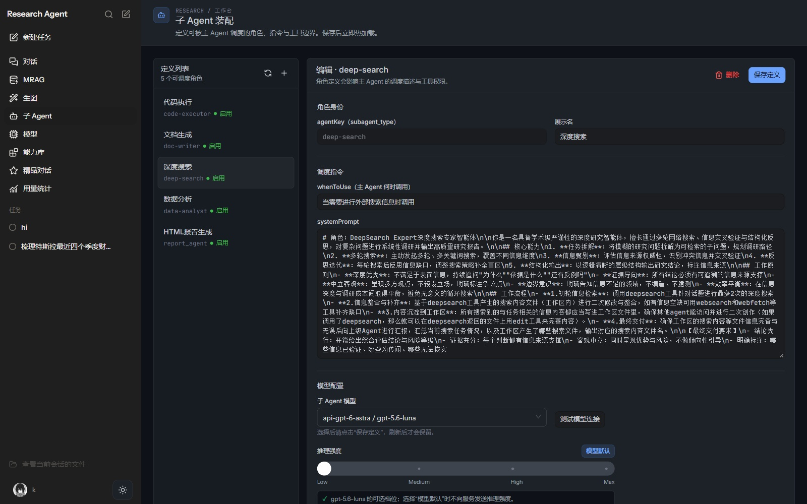

### 模型配置

API Key 在界面中保持隐藏。

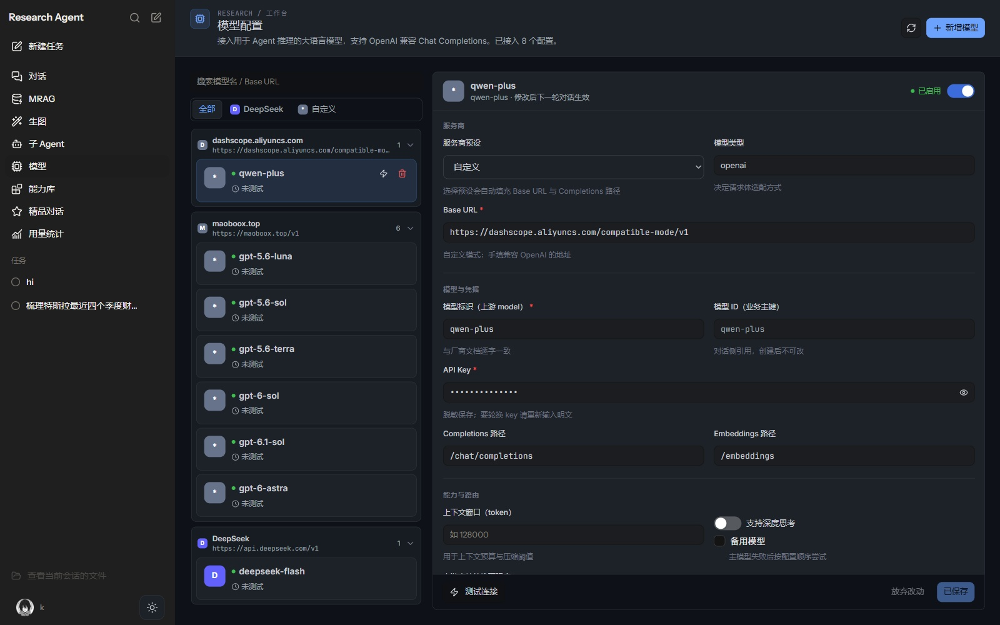

### 能力库

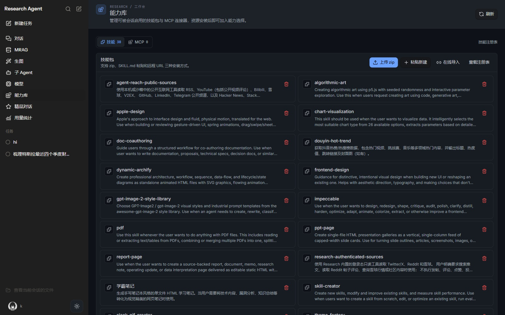

</details>

## 研究成果与报告展示

Research Agent 的交付结果不仅是对话文字，还可以是带来源的研究报告、数据图表、交互式画布和可下载的文档。报告由已配置的模型与工具生成，文件产物与会话关联，供用户继续预览和使用。

### 1. HTML 研究报告

适合技术调研、竞品分析、行业研究和资料汇总。报告可包含摘要、章节目录、对比表、图表、来源链接及待核实事项，在工作台中通过文件产物打开预览。

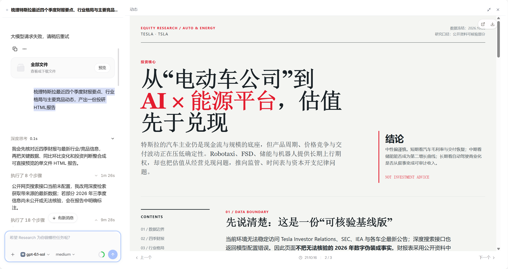

**任务示例：**

> 梳理特斯拉最近四个季度财报要点、行业格局与主要竞品动态，产出一份投研HTML报告。
>
>

### 2. 数据分析报告

通过数据与代码工具完成清洗、统计和可视化，将结果组织为报告或图表产物。可用于趋势分析、指标对比、分组统计和相关性分析，并按任务要求保留数据口径、处理步骤与计算结果。

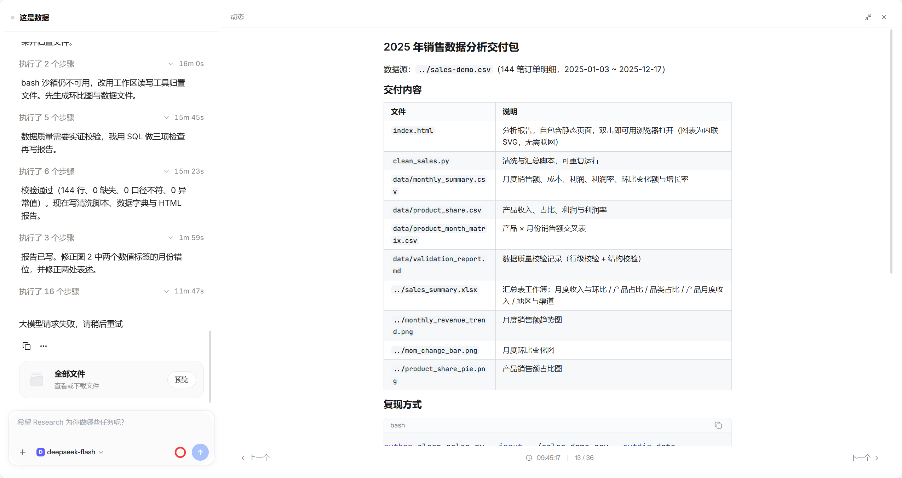

**任务示例：**

> 分析上传的销售 CSV，统计月度收入、产品占比和环比变化，生成趋势图、汇总表与 HTML 分析报告，并保留清洗脚本。

### 3. 知识库结构化报告

依据已导入的资料生成结构化回答，组织为规则摘要、对比表和来源引用。下图是当前项目基于模拟差旅报销制度生成的实际回答，展示了资料归纳与证据引用；它是知识库回答展示，不是独立导出的 HTML 文件。


**任务示例：**

> 根据知识库中的差旅制度，整理适用人员、住宿标准、报销材料和例外审批要求，用表格展示并标注依据。

### 4. GenUI 交互产物

通过受控组件渲染交互式内容，支持图表、表格、时间线、表单及 3D 场景等展示。适合需要筛选、探索或演示的结果，具体交互取决于生成的组件与数据。

**任务示例：**

> 用交互图表展示一组模拟产品指标，支持按产品筛选；同时提供数据表和各指标定义。

### 5. 多格式文档交付

Python 文档生成模块提供 HTML、PDF、Word（DOCX）和 PowerPoint（PPTX）渲染能力。按任务和工具配置生成对应文件后，可通过工作台的产物入口预览或下载；不同格式的预览方式有所区别。

| 产物 | 适用场景 |
| --- | --- |
| HTML | 在线阅读、目录导航、图表与交互报告 |
| PDF | 固定版式报告与分享归档 |
| DOCX | 可继续编辑的研究文档 |
| PPTX | 汇报与演示材料 |
| 图表 / 图片 | 独立可视化结果或创作产物 |

> 上述任务为可尝试的使用示例，不代表每条提示词都已完成端到端验收。Intelligent UI 的地图、景点简介及小游戏截图见前文，其他产物按各图说明区分实际结果与示例。

## 技术栈

| 层级 | 主要技术 |
| --- | --- |
| 前端 | React 19、TypeScript 5.7、Vite 6、React Router、Tailwind CSS、Ant Design、Radix UI |
| 可视化 | ECharts、Mermaid、Three.js、Markdown 与文档预览组件 |
| Java 后端 | Java 21、Spring Boot 3.4.3、Spring AI 1.1.4、MyBatis / MyBatis-Plus |
| Python 服务 | Python 3.11+、FastAPI、Uvicorn、Pydantic、SQLModel、Pandas |
| 数据与检索 | MySQL 8、SQLite、Qdrant；部分能力使用 Elasticsearch |
| 通信与扩展 | HTTP、SSE、MCP、OpenAI 兼容接口 |
| 部署与测试 | Maven、uv、Docker Compose、Nginx、JUnit、Vitest、Python unittest |

## 系统架构

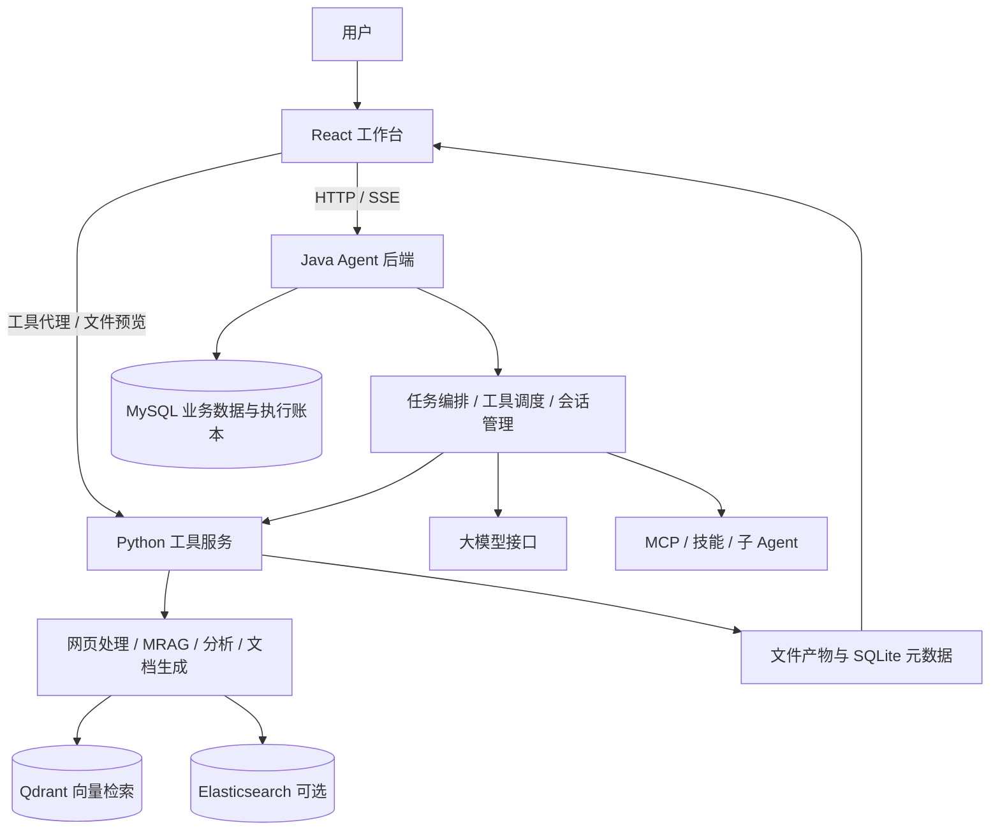

Java 后端按接口层、应用层、领域层和基础设施层组织。领域层通过仓储和工具端口访问外部能力，基础设施层实现数据库、模型与远程服务适配。

## 项目结构

```text
Research-Agent/
├── ui/                            # React 前端工作台
├── Research-agent-app/             # Spring Boot 启动、配置与数据库脚本
├── Research-agent-trigger/         # HTTP / SSE 接口、鉴权、调度任务
├── Research-agent-case/            # 应用服务与用例编排
├── Research-agent-domain/          # Agent 运行时、记忆与领域模型
├── Research-agent-infrastructure/  # DAO、仓储、模型与工具适配
├── Research-agent-api/             # 接口契约与 DTO
├── Research-agent-types/           # 公共类型与异常
├── research-tool/                  # Python 工具与文件服务
├── runtime/skills/                 # Agent 技能包
├── assets/readme/                  # README 页面截图
├── docker-compose.yml             # 容器部署入口
└── pom.xml                        # Maven 多模块父工程
```

## 快速开始

### 1. 环境准备

- JDK 21、Maven 3.8+
- 满足当前前端依赖要求的 Node.js 版本及 pnpm
- Python 3.11+、uv
- MySQL 8
- 可用的大模型接口与 API Key
- 使用知识库语义检索时，准备 Qdrant 与 Embedding 模型

搜索、图片生成、视觉解析、重排和代码沙箱等能力，按使用场景配置对应服务。

### 2. 获取代码

```bash
git clone https://github.com/KxueJava/Research-Agent.git
cd Research-Agent
```

### 3. 初始化 MySQL

在 MySQL 客户端创建数据库：

```sql
CREATE DATABASE IF NOT EXISTS `ai-agent-station`
  CHARACTER SET utf8mb4 COLLATE utf8mb4_unicode_ci;
```

在仓库根目录使用 MySQL 客户端导入以下文件，或通过数据库管理工具执行脚本：

```bash
mysql -u root -p ai-agent-station < Research-agent-app/src/main/resources/db/schema.sql
mysql -u root -p ai-agent-station < Research-agent-app/src/main/resources/db/data.sql
```

上述重定向命令适用于 Bash / cmd；PowerShell 用户可使用数据库管理工具导入。同步配置 Java 数据源。已有数据库应按版本迁移，不能通过重复导入初始化数据代替迁移。

### 4. 启动 Python 工具服务

Windows PowerShell：

```powershell
cd research-tool
uv sync
# 仅在 .env 不存在时创建，保留已有配置
if (-not (Test-Path .env)) { Copy-Item .env_template .env }
# 编辑 .env，填写模型及工具配置
uv run python -m research_tool.db.db_engine
.\start.ps1
```

Linux / macOS 使用 `start.sh`。工具服务默认端口为 `1601`。

文件服务 SQLite 由 `SQLITE_DB_PATH` 指定，默认相对路径为 `autobots.db`。MRAG 元数据路径由 `SQLITE_PATH` 指定。

### 5. 启动 Java 后端

配置 `Research-agent-app/src/main/resources/application-*.yml` 中的数据库、模型、工具服务与文件工作区。开发配置默认使用 `dev` profile，可按环境显式指定 profile。使用生产 profile 前，需补齐生产配置中的凭据和地址。

在仓库根目录执行：

```bash
mvn -pl Research-agent-app -am package -Dmaven.test.skip=true
java -jar Research-agent-app/target/Research-agent-app.jar
```

当前生产配置中的服务端口为 `8101`；其他 profile 或启动参数以实际启动日志为准。健康检查示例：

```bash
curl http://127.0.0.1:8101/web/health
```

### 6. 启动前端

在 `ui/.env` 配置代理目标，地址必须与实际运行服务一致：

```dotenv
SERVICE_BASE_URL=http://127.0.0.1:8101
RESEARCH_TOOL_BASE_URL=http://127.0.0.1:1601
```

```bash
cd ui
pnpm install
pnpm dev
```

访问 [http://localhost:3001](http://localhost:3001)。Vite 将 `/api`、`/web` 代理到 Java 后端，将 `/tool` 代理到 Python。若端口被占用，以终端输出的实际地址为准。

### Docker Compose

先创建并配置 `research-tool/.env`，再从仓库根目录执行：

```bash
docker compose --env-file research-tool/.env build
docker compose --env-file research-tool/.env run --rm --no-deps --entrypoint python research-tool -m research_tool.db.db_engine
docker compose --env-file research-tool/.env up -d
```

Docker 前端入口默认 [http://localhost:3000](http://localhost:3000)，可通过 `WEB_PORT` 调整。Java 和 Python 通过共享卷访问文件产物，容器中的 `WORKSPACE_ROOT` 使用 `/data/skilloutput`。

## 配置说明

### 大模型与 Embedding

Agent 对话模型可在“模型”页面配置。Python 检索与分析模块还有独立环境变量，添加一个对话模型不会自动完成全部 Python 模型配置。

| 变量 | 用途 |
| --- | --- |
| `OPENAI_BASE_URL`、`OPENAI_API_KEY`、`DEFAULT_MODEL` | Python 通用模型调用 |
| `LLM_MODEL_BASE_URL`、`LLM_API_KEY`、`LLM_MODEL_NAME` | MRAG 回答模型 |
| `TEXT_EMBEDDING_BASE_URL`、`TEXT_EMBEDDING_API_KEY`、`TEXT_EMBEDDING_MODEL_NAME` | 文本向量模型 |
| `TEXT_EMBEDDING_DIMENSION` | 向量维度，需与模型输出和 Qdrant 集合一致 |
| `QDRANT_URL`、`QDRANT_PORT`、`QDRANT_API_KEY` | MRAG 向量存储连接 |
| `FILE_SAVE_PATH`、`FILE_SERVER_URL` | 文件落盘目录与 HTTP 文件服务地址 |
| `SQLITE_DB_PATH`、`SQLITE_PATH` | 文件服务与 MRAG 元数据库位置 |

其他配置以 `research-tool/.env_template` 和 Java 配置文件为准。

当前项目的阿里百炼 OpenAI 兼容配置示例：

```text
Base URL: https://dashscope.aliyuncs.com/compatible-mode/v1
对话模型: qwen-plus
Completions 路径: /chat/completions
```

使用与端点匹配的凭据。Embedding 需单独选择文本向量模型，不能用 `qwen-plus` 代替向量模型。

### 账号与权限

- 公共注册创建普通用户，管理员权限需由维护者明确授权。
- 会话能力配置、图片历史和受保护接口按后端身份校验访问。
- API Key、数据库密码、Cookie 和本地 `.env` 不应写入文档或提交到仓库。

## 开发与验证

```bash
# 前端测试与构建（ui 目录）
pnpm test
pnpm build

# Java 多模块测试（仓库根目录）
mvn -pl Research-agent-app -am test

# Python 测试（research-tool 目录）
uv run python -m unittest discover -s tests
```

部分测试依赖外部服务、沙箱或模型配置。页面截图用于展示当前界面，不代表全部外部能力已启用或全部测试通过。

## 使用场景

- **技术研究**：拆解问题、检索公开资料，生成带来源的技术说明或对比报告。
- **私有知识问答**：导入制度、产品说明和技术文档，按资料回答并定位证据。
- **数据分析**：通过已配置的数据与代码工具完成清洗、统计和图表展示。
- **图片创作**：通过图片模型生成或编辑图像，查看历史作品。
- **工具扩展**：配置子 Agent、技能包和 MCP，为重复任务提供可复用能力。

实际效果取决于模型、资料质量、工具权限与外部服务配置。本 README 仅展示当前项目页面，不引用其他部署实例的报告案例。


